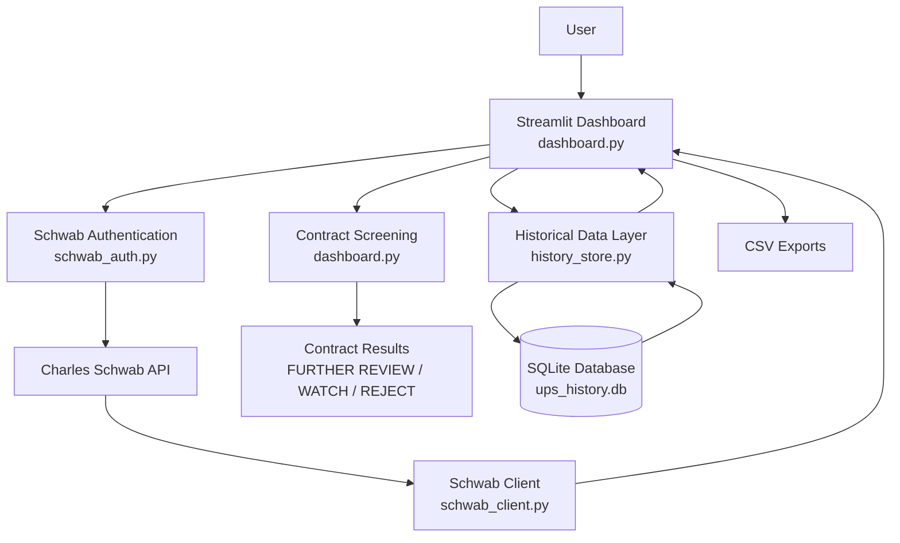

# Application Architecture

## Overview

UPS Income Generator is a local Python application that combines market-data retrieval, options-contract screening, historical persistence, and interactive visualization.

The application uses Streamlit as its user interface, a Schwab client for market-data requests, and SQLite for local historical storage.

## Architecture Diagram



## Components

### 1. Streamlit Dashboard — `dashboard.py`

The main application entry point.

Responsibilities:

- Render the interactive dashboard.
- Collect screening parameters.
- Request market data through the Schwab client.
- Process option-chain information.
- Display contract metrics and screening results.
- Display historical observations.
- Provide CSV downloads.

### 2. Authentication — `schwab_auth.py`

Provides the local Schwab authentication functionality used by the application.

Authentication credentials and token material must remain local and must never be committed to the public repository.

### 3. Market Data Client — `schwab_client.py`

Provides the interface to Schwab market-data endpoints.

The dashboard uses it to retrieve:

- UPS underlying quotes.
- UPS call-option chain data.

The current dashboard requests an expiration window of approximately 30–45 days.

### 4. Contract Screening — `dashboard.py`

The dashboard evaluates returned contracts using available market information and user-selected screening parameters.

Screening considerations include:

- Strike range.
- Bid and ask.
- Spread percentage.
- Delta.
- Volume.
- Open interest.
- Quote age.
- Delayed-market-data status.

The resulting statuses are:

| Status | Meaning |
|---|---|
| FURTHER REVIEW | No automated rejection reason or warning was triggered |
| WATCH | One or more data-quality or market-condition warnings were detected |
| REJECT | One or more screening rejection conditions were detected |

These are screening labels, not trading recommendations.

### 5. Historical Persistence — `history_store.py`

Uses SQLite to preserve historical observations.

The database contains two principal tables:

- `snapshots`: Records the time of capture, underlying price, quote timestamp, delayed-data indicator, session-clock indicator, and number of saved contracts.
- `option_quotes`: Stores individual contract observations associated with a snapshot.

The historical tracker records the complete standard 100-share call chain returned by the client rather than only contracts matching the dashboard's current display filters.

### 6. Local Database

Default database location:

```text
data/ups_history.db
```

The database is generated locally and should not be committed if it contains personal or sensitive trading data.

### 7. Export Layer

The dashboard provides CSV downloads for:

- Screened option contracts.
- Historical option observations.

## Data Flow

1. The user opens the Streamlit dashboard.
2. The user selects the market-data refresh action.
3. The dashboard initializes the Schwab client.
4. The client retrieves the UPS quote and option chain.
5. The dashboard extracts underlying-price information.
6. The screening logic evaluates returned contracts.
7. Historical observations are saved to SQLite.
8. Results are displayed in the dashboard.
9. The user can download CSV exports.

## Security Boundaries

The application is designed for local analytical use.

- Schwab credentials must remain outside source control.
- OAuth tokens must remain outside source control.
- Local databases should not be published if they contain personal information.
- No brokerage order-entry functionality is implemented.
- No brokerage account positions or balances are retrieved by the dashboard.

## Current Operational Limitations

- Historical collection is manually triggered.
- There is no background market-data polling service.
- The regular-session indicator is clock-based and does not include exchange holidays or early closes.
- Market-data freshness must be independently checked.
- Screening results require human review.

## Potential Future Enhancements

These are possible future development items, not current capabilities:

- Background market-data collection.
- Configurable portfolio and cost-basis settings.
- Automated data-quality monitoring.
- Additional symbols and option strategies.
- Historical performance analytics.
- Automated test and deployment workflows.
- Containerized deployment.
